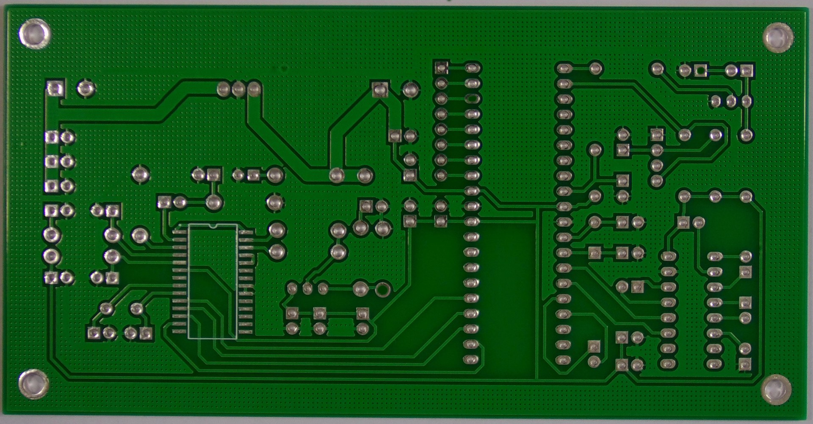
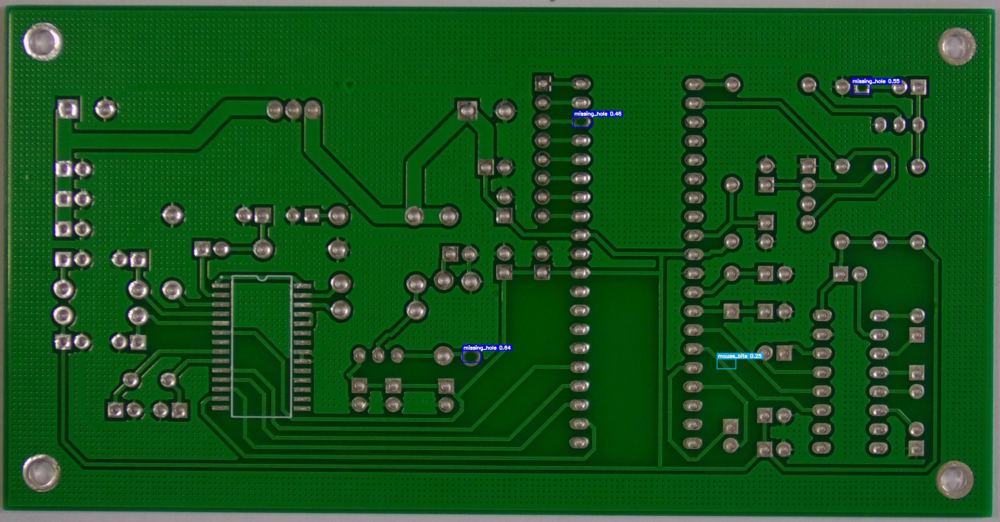
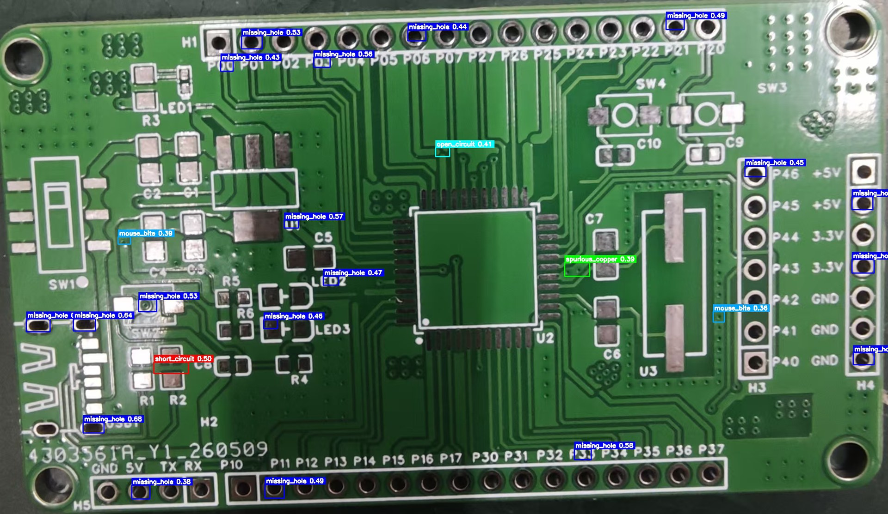
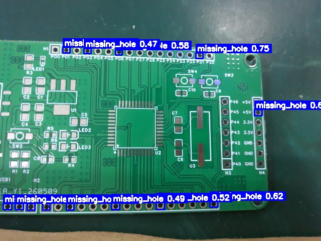
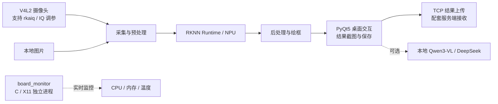

# PCB Defect Inspector

> 基于 **ELF 2（RK3588）** 的边缘端 PCB 缺陷检测系统 ｜ RKNN INT8 NPU 推理 · PyQt5 桌面交互 · V4L2 实时检测 · C/X11 系统监控 · 本地 Qwen3-VL 辅助分析

## 效果展示

| 图片输入 | 检测输出 |
| --- | --- |
|  |  |

| 多缺陷检测输出 | 板端摄像头实时画面 |
| --- | --- |
|  |  |

> 完整 PyQt5 主界面交互与实时视频推理效果，可直接查看仓库中的演示视频。

## 核心功能与系统架构

- **多源检测与跟踪**：支持本地图片与 V4L2 摄像头实时输入，通过 RKNN Runtime 在 RK3588 NPU 上运行 6 类 PCB 缺陷量化检测模型（`PCB_Improve.rknn`），内置后处理与目标跟踪逻辑。
- **桌面交互与结果回传**：基于 PyQt5 实现模型切换、阈值配置与结果可视化；支持检测画面本地落盘、自定义 TCP 协议上传检测结果，以及通过 HTTP 接口拉取更新模型。
- **轻量级板端监控（`board_monitor`）**：采用纯 C + X11 实现独立系统监控进程，低资源占用实时展示 CPU、内存与板端温度，与 Python 主程序解耦运行。
- **多模态辅助分析（可选）**：支持调用板端本地 Qwen3-VL 推理程序进行缺陷辅助分析，并预留 DeepSeek API 接入配置。



## 板端性能基准

在 **ELF 2（RK3588 / Ubuntu 22.04 / `librknnrt 2.3.2`）** 上，使用 `PCB_Improve.rknn`（置信度阈值 `0.25`，NMS IoU `0.45`）完成 300 张 6 类 PCB 样本的端到端离线批测，完整聚合数据见 [pcb-300-summary.json](docs/benchmarks/pcb-300-summary.json)。

| 指标 | 实测结果 | 测量口径 |
| :--- | ---: | :--- |
| **单帧 NPU 推理耗时（Avg / P95）** | **30.30 ms / 36.12 ms** | 仅统计 `rknn.inference` 调用，不含读图、绘框与落盘 |
| **单图端到端耗时（Avg / P95）** | **139.06 ms / 197.91 ms** | 包含读图、色彩转换、NPU 推理、后处理、绘框与保存全流程 |
| **批处理综合吞吐** | **7.18 img/s** | 300 张样本连续处理总耗时 41.78 s（含绘框落盘，不含模型加载） |
| **进程内存峰值（RSS）** | **294.0 MiB** | 运行期间周期采样峰值 |
| **抽检类别命中率** | **87.33%** | 300 张样本（6 类各 50 张）图像级命中 262 / 300；Top-1 最高置信度命中 245 / 300（81.67%） |

> **性能瓶颈分析**：纯 NPU 推理耗时仅占单图全链路耗时的 **~21.8%**，剩余近 80% 开销集中在 CPU 侧的图像编解码、色彩空间转换与绘图落盘。批测同时用于验证量化部署后的推理链路可用性与延迟稳定性，类别命中率按图像级期望类别口径统计。

## 目录结构

```text
pcb-defect-inspector/
├── pcb_defect_inspector/     # PyQt5 主应用、RKNN 推理、TCP 上传与多模态分析
│   ├── detection/            # 模型推理、YOLO 后处理与跟踪
│   ├── ui/                   # 图片检测、摄像头视图与设置对话框
│   ├── upload/               # 自定义 TCP 文件上传协议
│   ├── utils/                # 本地配置管理、模型下载与路径工具
│   ├── vl/ deepseek/         # 可选多模态分析客户端
│   ├── models/.gitkeep       # 模型权重存放目录
│   └── outputs/.gitkeep      # 检测结果输出目录
├── board_monitor/            # 独立 C / X11 板端状态监控
├── scripts/                  # 离线批测、TCP 上传验证、相机检查与轻量原型脚本
├── deploy/                   # 启动脚本、桌面快捷方式、背光与相机 IQ 说明
├── docs/assets/              # 效果展示图片
├── docs/benchmarks/          # 脱敏后的板端性能聚合记录
├── requirements.txt
└── README.md
```

## ELF 2 部署指南

### 1. 已验证软硬件环境

- **硬件平台**：ELF 2（RK3588 / AArch64）
- **系统与运行时**：Ubuntu 22.04.5 LTS / Linux 5.10.209 / Python 3.10.12
- **多媒体与 NPU 库**：`librknnrt.so` 2.3.2、RGA 2.2.0、MPP 1.5.0、FFmpeg 6.0.1

部署前先确认板端 NPU 运行库与相机服务正常：

```bash
uname -m
python3 --version
ldconfig -p | grep -E 'librknnrt|librga|rockchip_mpp'
python3 -c 'from rknnlite.api import RKNNLite; print("rknnlite OK")'
v4l2-ctl --list-devices
systemctl status rkaiq_3A.service --no-pager
```

### 2. 安装 Python 依赖

推荐优先复用板卡镜像自带的 PyQt5 与 OpenCV/GStreamer 依赖，避免破坏 V4L2 相机管线。在项目根目录执行：

```bash
sudo apt update
sudo apt install -y python3-pip python3-pyqt5 python3-opencv v4l-utils libx11-dev
python3 -m pip install --user -r requirements.txt

# 安装与当前架构及 Python 版本匹配的 RKNN Toolkit Lite2 wheel 包
python3 -m pip install --user /path/to/rknn_toolkit_lite2-2.3.2-cp310-cp310-manylinux_2_17_aarch64.manylinux2014_aarch64.whl
```

### 3. 获取模型与初始化配置

模型权重通过 [GitHub Releases v1.0.0](https://github.com/yaohaoying-source/pcb-defect-inspector/releases/tag/v1.0.0) 分发，下载 `PCB_Improve.rknn` 并放入 `pcb_defect_inspector/models/`（校验信息见 [docs/MODEL_WEIGHTS.md](docs/MODEL_WEIGHTS.md)）。

复制配置模板并按实际环境修改服务端地址、端口或可选 API 密钥：

```bash
mkdir -p ~/.config/PCBDefectInspector
cp deploy/YOLO-COCO-Detect.conf.example ~/.config/PCBDefectInspector/PCB-Defect-Inspector.conf
${EDITOR:-vi} ~/.config/PCBDefectInspector/PCB-Defect-Inspector.conf
bash deploy/start_pcb_inspector.sh
```

> 应用设置界面支持在线编辑以上参数；若从旧版板端环境迁移，可在设置对话框点击 **导入旧版板端设置**，程序会在确认后仅补齐缺失字段而不覆盖现有配置。如不使用 DeepSeek 分析功能，保持对应密钥为空即可。

### 4. 编译板端监控与桌面配置

编译并启动独立系统监控工具（需处于 X11 图形会话中）：

```bash
make -C board_monitor
bash board_monitor/start_board_monitor.sh
```

- **相机调参**：摄像头设备节点随接入顺序变化，可在界面中直接切换；相机 IQ 文件说明见 [deploy/camera/README.md](deploy/camera/README.md)。
- **桌面快捷方式**：将 `deploy/` 下的 `.desktop` 模板中的 `__REPO_ROOT__` 替换为仓库绝对路径后放入 `~/.local/share/applications/`（路径含空格时保留双引号）。
- **可选背光配置**：如需开机自动调亮 DSI 屏幕背光，先确认 `/sys/class/backlight/backlight-dsi0` 存在，再执行 `sudo bash deploy/backlight/install-backlight-max.sh`。

### 5. 可选：本地 Qwen3-VL 辅助分析

在应用的 Qwen3-VL 设置页指定板端本地推理目录（需包含兼容当前固件的 `demo`、`imgenc`、运行库及对应的视觉 `.rknn` 与语言 `.rkllm` 权重），即可在检测完成后触发辅助分析。

## 批测与调试脚本

在板端准备好外部测试集（含 `labels.csv` 与 `images/`）后，可直接复现离线批测或检查相机参数：

```bash
# 运行离线批测（结果默认输出至 outputs/benchmarks/）
python3 scripts/pcb_300_batch_test.py --dataset /path/to/pcb_test_300 --model pcb_defect_inspector/models/PCB_Improve.rknn

# 检查 V4L2 摄像头控制项
bash scripts/inspect_camera_controls.sh
```

- 如需测试 TCP 上传或命令行单摄像头检测原型，可分别通过 `--help` 查看参数说明：
  `python3 scripts/pcb_tcp_upload_sample.py --help` / `python3 scripts/pcb_detect.py --help`。

## 后续优化方向

- **预处理硬件加速**：使用 RK3588 **RGA** 替代部分 CPU 侧图像缩放与色彩空间转换，降低单图端到端耗时。
- **异步流水线解耦**：进一步拆分摄像头采集、NPU 推理与 UI 渲染线程，并结合 RK3588 多核 NPU 调度提升实时视频流帧率。

## License

本项目采用 [MIT License](LICENSE) 开源；提交或二次分发时请勿包含真实密钥、私有网络配置及未授权数据集。